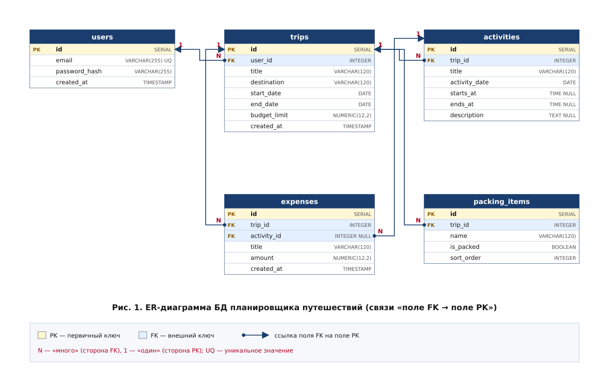
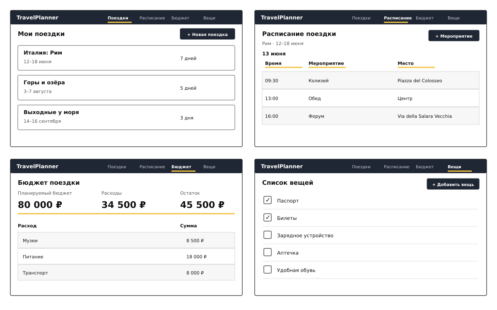

# Отчёт по проекту «TravelPlanner — планировщик путешествий»

**Дисциплина** — СПО.

**Год** — 2026.

**Результат** — веб-приложение для ведения личных поездок.

## Содержание

1. [Введение](#1-введение)
2. [Анализ предметной области](#2-анализ-предметной-области)
3. [Техническое задание](#3-техническое-задание)
4. [Бизнес-логика](#4-бизнес-логика)
5. [Проектирование](#5-проектирование)
6. [Проектирование API](#6-проектирование-api)
7. [План тестирования и результаты](#7-план-тестирования-и-результаты)
8. [Заключение](#8-заключение)

## 1. Введение

Во время подготовки путешественник несколько раз пересматривает план. Перенос экскурсии меняет расписание, а стоимость уже купленного билета продолжает влиять на бюджет. Если расписание и суммы ведутся отдельно, после каждого изменения приходится заново сверять записи.

Цель проекта — дать путешественнику одну карточку для организации уже выбранной поездки. Для этого реализованы личные аккаунты, учёт поездок, расписание, бюджет и список вещей. Границы проекта определены в [исходном описании](../README.md#1-функциональные-возможности).

## 2. Анализ предметной области

| Понятие | Значение в приложении |
|---|---|
| Поездка | План одного владельца с названием, направлением, диапазоном дат и бюджетом |
| Мероприятие | Пункт расписания на конкретную дату с необязательным временем и описанием |
| Расход | Планируемая трата, общая для поездки или связанная с мероприятием |
| Остаток | Разность между лимитом поездки и суммой её расходов |
| Вещь | Позиция личного списка с отметкой о сборе |

Календарь помогает увидеть занятые часы, таблица — сложить траты, чек-лист — проверить багаж. В TravelPlanner все записи принадлежат поездке. Благодаря этой связи путешественник может открыть свой план на день и одновременно увидеть, сколько денег осталось на поездку и сколько вещей уже собрано.

## 3. Техническое задание

Гость может создать аккаунт или войти по email и паролю. После входа пользователь работает со своими поездками. Даты вводятся в календарных днях, время мероприятий — местное, суммы — в рублях с точностью до копейки.

| Код | Входные данные и действие | Наблюдаемый результат и критерий приёмки |
|---|---|---|
| F1 | Ввести название, направление, даты и лимит | Поездка появляется в личном списке, изменения сохраняются после повторного входа. Удаление требует подтверждения в интерфейсе |
| F2 | Добавить мероприятие и изменить дату | Запись появляется в группе нового дня. Ввод даты вне поездки вызывает ошибку |
| F3 | Указать лимит и добавить, изменить или удалить расход | При каждом сохранении видны сумма расходов и новый остаток |
| F4 | Добавить вещь и поставить отметку о сборе | Флажок и счётчик отражают состояние из базы после повторного открытия |
| F5 | Открыть карточку поездки | Даты, бюджет и готовность к отъезду видны над вкладками расписания, расходов и вещей |

Сервер проверяет входные данные и права на конкретную поездку. Пароль хранится в виде хеша scrypt с индивидуальной солью. Браузер получает cookie с атрибутами HttpOnly и SameSite=Strict. Сеанс действует семь дней и отзывается при выходе. В PostgreSQL изменения одной поездки сериализуются блокировкой её строки, чтобы параллельное сокращение дат и добавление мероприятия сохраняли целостность расписания.

## 4. Бизнес-логика

### Расписание и изменение дат

Начальный и конечный дни входят в период поездки. Конец мероприятия допускается при заданном начале и должен быть в тот же день, в момент начала или позже. Мероприятия располагаются по дате и времени. Записи без времени завершают группу своего дня. Если новые даты поездки исключают существующее мероприятие, пользователь сначала переносит или удаляет этот пункт.

### Расчёт бюджета

Расход должен быть положительным, лимит может равняться нулю. Сервер складывает расходы одной поездки с десятичной точностью и вычитает результат из лимита. Отрицательный остаток показывает размер перерасхода. При удалении мероприятия внешняя ссылка расхода обнуляется. Этот расход по-прежнему входит в итог.

**Контрольный пример.** Для поездки в Казань на 12–14 июня задан лимит 1 000,00 ₽. Билет относится к экскурсии 13 июня, обед записан как самостоятельный расход.

| Шаг | Сумма расходов | Остаток |
|---|---:|---:|
| Добавить билет за 850,35 ₽ | 850,35 ₽ | 149,65 ₽ |
| Добавить обед за 249,90 ₽ | 1 100,25 ₽ | −100,25 ₽ |
| Удалить экскурсию из расписания | 1 100,25 ₽ | −100,25 ₽ |
| Исправить стоимость билета на 800,10 ₽ | 1 050,00 ₽ | −50,00 ₽ |
| Удалить расход «Билет» | 249,90 ₽ | 750,10 ₽ |

### Подготовка вещей

Новая вещь добавляется в конец списка. Числитель счётчика равен количеству отмеченных позиций, знаменатель — общему числу вещей. Пользователь может снять отметку или удалить позицию. Изменения багажа не влияют на расписание и расходы.

## 5. Проектирование

React формирует страницы и отправляет JSON в FastAPI. Pydantic проверяет типы и ограничения полей, маршруты проверяют правила предметной области, SQLAlchemy выполняет запросы в транзакции. В Docker приложение использует PostgreSQL, локально можно работать с SQLite. Схема создаётся одной версионированной миграцией Alembic.

| Таблица | Основные поля и связи |
|---|---|
| users | Уникальный email, хеш пароля, дата регистрации |
| sessions | Хеш идентификатора сеанса, ссылка на владельца, срок действия. Служебная таблица авторизации |
| trips | Владелец, название, направление, даты, лимит и время создания |
| activities | Ссылка на поездку, название, дата, начало, окончание и описание |
| expenses | Ссылки на поездку и необязательное мероприятие, название, сумма и время создания |
| packing_items | Ссылка на поездку, название вещи, состояние и порядок в списке |

При удалении поездки база каскадно удаляет её расписание, расходы и вещи. Проверка владельца и проверка принадлежности мероприятия одной поездке действуют и при запросах напрямую к API.

Акторы и варианты использования приведены в [диаграммах Use Case](../README.md#2-диаграмма-вариантов-использования-use-case). Последовательность действий от регистрации до корректировки поездки показана на [диаграмме бизнес-процесса](../README.md#3-диаграмма-бизнес-процесса-bpmn).

## 6. Проектирование API

Все пути в таблице начинаются с `/api`. Для работы с поездками требуется действующий сеанс.

| Метод | Путь | Результат |
|---|---|---|
| POST | /auth/register, /auth/login | Создать аккаунт или проверить пароль, выдать cookie |
| GET | /auth/me | Вернуть идентификатор и email текущего пользователя |
| POST | /auth/logout | Отозвать текущий сеанс |
| GET, POST | /trips | Прочитать личный список или создать поездку |
| GET | /trips/{id} | Получить сведения о поездке, массивы мероприятий, расходов и вещей, сумму и остаток |
| PUT, DELETE | /trips/{id} | Заменить поля поездки или удалить её с зависимыми записями |
| POST | /trips/{id}/activities | Создать мероприятие |
| POST | /trips/{id}/expenses | Добавить расход с необязательным activity_id |
| POST | /trips/{id}/items | Добавить вещь |
| PUT, DELETE | /trips/{id}/{collection}/{row_id} | Изменить или удалить запись в activities, expenses или items |

Например, запрос `POST /api/trips/1/expenses` с телом `{"title":"Билет","amount":"850.35","activity_id":2}` связывает расход с мероприятием № 2 поездки № 1. В ответ на создание сервер возвращает статус 201 и идентификатор новой записи. Если мероприятие относится к другой поездке, сервер возвращает 422. Отсутствующий сеанс даёт 401, недоступная поездка — 404, повторная регистрация email — 409.

## 7. План тестирования и результаты

Для тестов API миграция создаёт базу SQLite во временном каталоге. После каждого сценария выполняется откат схемы. Контрольный пример бюджета проверяется по числам из раздела 4.

| Проверка | Ожидаемый результат | Результат |
|---|---|---|
| Регистрация, повторная регистрация, выход, неверный и верный пароль | Уникальный аккаунт, отзыв сеанса, повторный вход | Пройдено |
| Редактирование поездки | Новое название в списке, ошибки на пустое название, неверные даты и отрицательный бюджет | Пройдено |
| Расписание | Сортировка, перенос, проверка времени и границ поездки | Пройдено |
| Бюджет и удаление мероприятия | Сохранение траты и точные итоги контрольного примера | Пройдено |
| Некорректные суммы | Отклонены ноль, отрицательная сумма, доли копейки и превышение разрядности | Пройдены 4 случая |
| Список вещей и удаление поездки | Флажок переключается в обе стороны, дочерние записи удаляются вместе с поездкой | Пройдено |
| Доступ второго пользователя | Личный список пуст, нельзя прочитать или изменить чужую поездку и привязать её мероприятие | Пройдено |

**Итого** — 10 пройденных тестов pytest. Собранный React-клиент дополнительно проверен в DOM-окружении с отправкой запросов в FastAPI. Проверены регистрация, создание поездки, мероприятие, расход с привязкой, остаток, отметка вещи и повторный вход. Конфигурация Compose прошла проверку, для PostgreSQL сгенерирован SQL миграции. Проверка в графическом браузере и запуск контейнеров с живым PostgreSQL остаются для среды с доступными браузером и Docker Engine.

Команды воспроизведения приведены в [инструкции запуска](../README.md#8-запуск). Проверки API находятся в [тестовом модуле](../backend/tests/test_planner.py).

## 8. Заключение

Реализованы все пять функций из технического задания. Пользователь может спланировать день, сверить остаток и отметить собранные вещи в рамках одной поездки. Контрольный пример подтвердил важное правило предметной области — отмена мероприятия сама по себе не отменяет связанную с ним трату.

Работа по этапам отражена в отчётах за [неделю 2](WEEK%202.md) и [неделю 3](WEEK%203.md).
